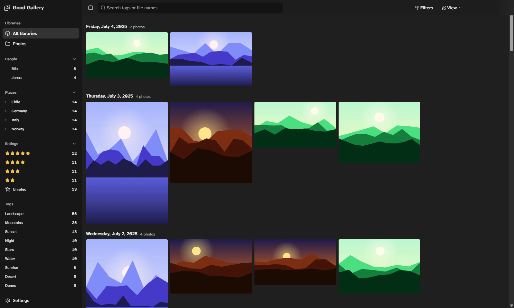
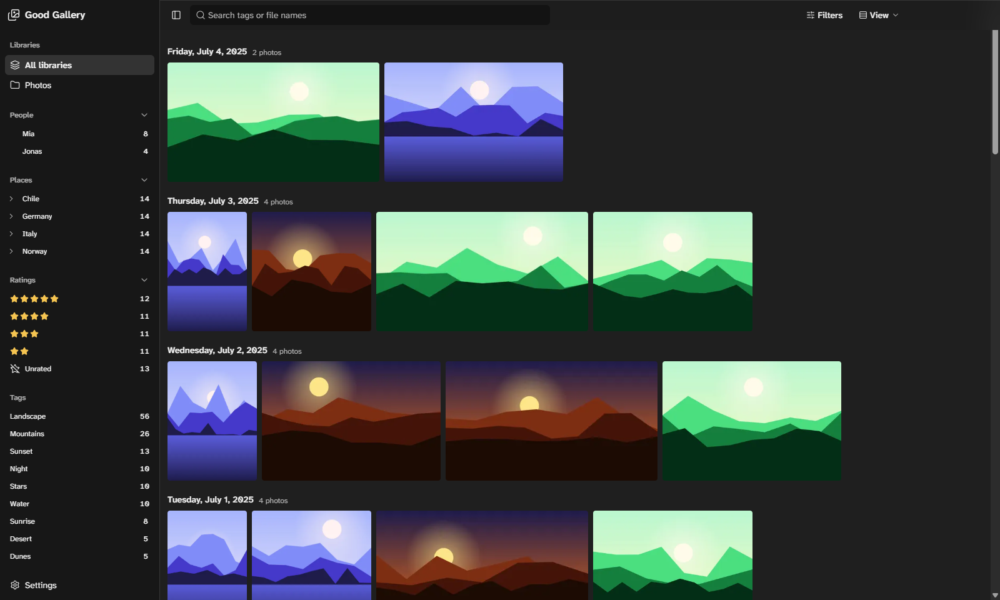
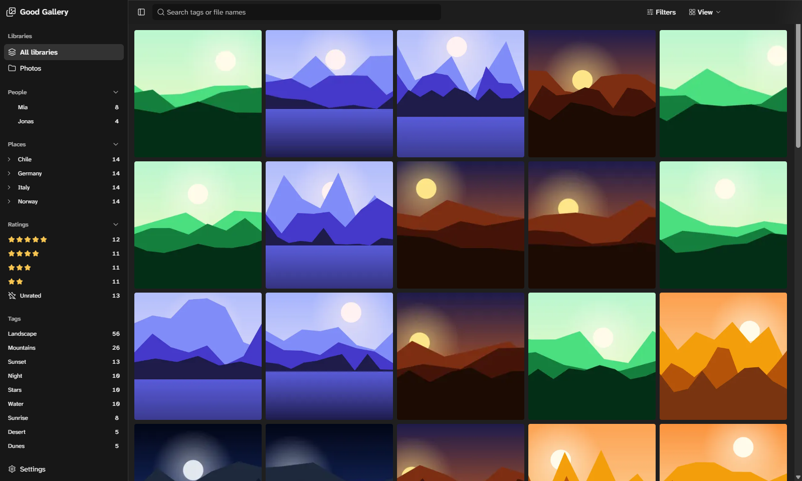
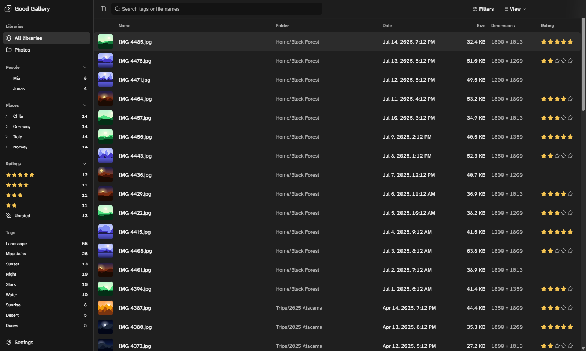
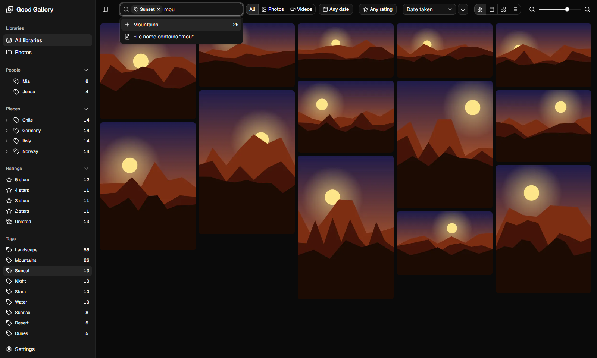
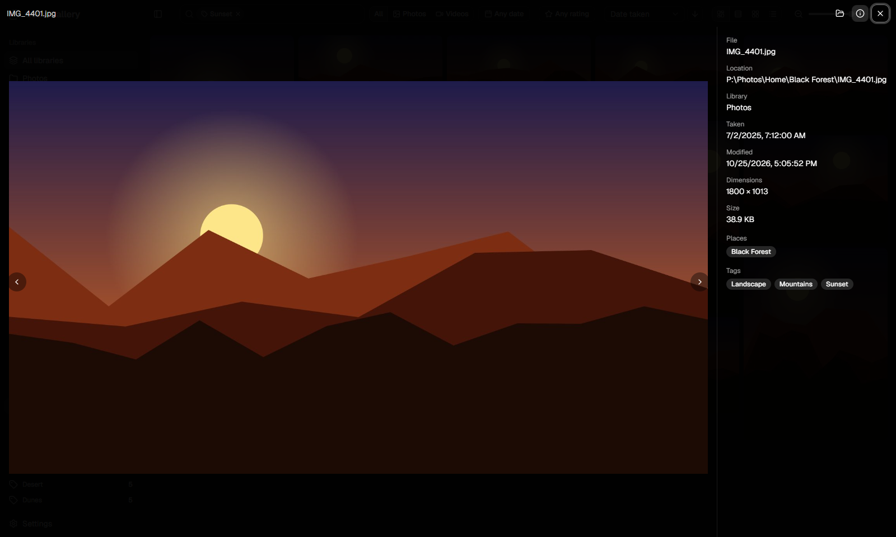

# Good Gallery

A Windows desktop gallery for large photo and video libraries (50k–500k files). Media appear in a virtualized masonry, justified, grid or list view. Libraries on network shares are supported, and thumbnails are cached locally. Search uses the tags that are already embedded in your files.



## Features

- **Views:** Masonry (columns), Justified (rows of equal height), Grid (square tiles) and List (details). All are virtualized, so they stay fast at any library size. Switch views, zoom and sort under _View_, or zoom with Ctrl + mouse wheel.
- **Network shares:** libraries can live on `\\server\share`. Thumbnails (WebP and ThumbHash placeholders) are cached locally, and the cached index stays browsable while a share is offline.
- **Change detection:** a file watcher picks up changes, plus periodic quick scans. Manual rescans are also possible.
- **Search:** combine tags (include or exclude, hierarchical), filename text and folder; media type, date range and rating are under _Filters_. Sort by date taken, date modified, name, path or size.
- **Sidebar:** libraries with a folder tree, People and Places (from keyword hierarchies and face regions), ratings and popular tags.
- **Viewer:** the photo floats over the blurred window, with controls that step aside while you look. Keyboard navigation, zoom and pan, video playback, a metadata panel and "Show in Explorer".
- **Look:** dark, neutral chrome so only your photos bring color; the toolbar and menus are frosted glass over the gallery.
- **Read-only:** tags and ratings come from EXIF / IPTC / XMP and `.xmp` sidecars. Files are never modified.

| Justified                                                   | Grid                                            |
| ----------------------------------------------------------- | ----------------------------------------------- |
|            |          |
| **List**                                                    | **Tag search**                                  |
|  |  |



Supported formats: JPEG, PNG, WebP, GIF and AVIF images, plus videos (with poster-frame thumbnails).

## Requirements

- Windows
- Node 24 and pnpm 12. The versions are pinned in `mise.toml`.

## Getting started

```sh
pnpm install
pnpm dev
```

Add a library folder under **Settings**.

| Script             | Purpose                                                |
| ------------------ | ------------------------------------------------------ |
| `pnpm dev`         | Run the app with hot reload                            |
| `pnpm build`       | Build into `out/`                                      |
| `pnpm dist`        | Build the installer (`setup.exe`) and the portable zip into `release/<version>/` |
| `pnpm format`      | Format and lint with Biome (`pnpm lint` only checks)   |
| `pnpm typecheck`   | Type-check the node, web and e2e projects              |
| `pnpm test`        | Unit tests (Vitest)                                    |
| `pnpm test:e2e`    | Build, then run the Playwright Electron smoke test     |
| `pnpm screenshots` | Build, then render the README screenshots into `docs/screenshots/` from a generated demo library |
| `pnpm db:generate` | Generate a Drizzle migration after changing the schema |
| `pnpm release`     | Cut a release: bump the version, update `CHANGELOG.md`, tag and push (`-- --dry-run` previews) |

## Development

CI ([.github/workflows/ci.yml](.github/workflows/ci.yml)) lints, type-checks and runs the unit and e2e tests on every push and pull request; pull requests into `main` need it to pass.

### Releases

Commit messages follow [Conventional Commits](https://www.conventionalcommits.org) (`feat: …`, `fix(viewer): …`, `feat!: …` for breaking changes). On an up-to-date, clean `main`, run `pnpm release`. It derives the next version from the commits since the last tag (breaking → major, or minor before 1.0; `feat` → minor; else patch), shows the release notes and asks before it commits `CHANGELOG.md`, tags `vX.Y.Z` and pushes. Pass `major`, `minor`, `patch` or a version like `1.2.3` to override, `--yes` to skip the question. The pushed tag starts the [release workflow](.github/workflows/release.yml): it runs the checks, builds the installer and the portable zip, smoke-tests the app and publishes the GitHub release.

The downloads aren't code-signed, and reputation-based antivirus may quarantine unsigned executables. After each release, submit `setup.exe` and the zip as false positives at [Microsoft Security Intelligence](https://www.microsoft.com/en-us/wdsi/filesubmission) so Defender learns they're clean.

- [docs/architecture.md](docs/architecture.md): architecture and tech stack
- [docs/glossary.md](docs/glossary.md): domain terms
- [AGENTS.md](AGENTS.md): working guidelines for coding agents

## License

[GPL-3.0](LICENSE). The bundled ffmpeg build (`ffmpeg-static`) is GPL-3.0 as well.
