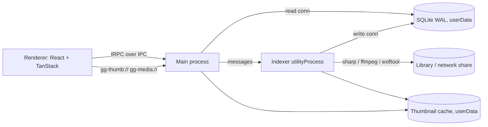

# Architecture

| Folder         | Role                                                                                       |
| -------------- | ------------------------------------------------------------------------------------------ |
| `src/main`     | Window and security, tRPC router over IPC, custom protocols, settings, scan scheduling     |
| `src/indexer`  | `utilityProcess`: scanning, file watcher, metadata (exiftool), thumbnails (sharp / ffmpeg) |
| `src/preload`  | Exposes only the tRPC IPC transport through `contextBridge`                                |
| `src/renderer` | React UI (TanStack Router / Query / Virtual, shadcn, Tailwind)                             |
| `src/shared`   | Code used by several processes (settings schema, tag helpers, media URLs, …)               |
| `drizzle/`     | SQL migrations, shipped with the app and applied at startup                                |
| `e2e/`         | Playwright smoke test against a generated fixture library                                  |

## Tech stack

| Concern   | Technology              | Purpose                                             |
| --------- | ----------------------- | --------------------------------------------------- |
| Framework | Electron, electron-vite | Desktop application framework                       |
| Framework | electron-builder        | Windows installer                                   |
| UI        | React                   | Component framework                                 |
| UI        | Tailwind CSS            | Styling, replaces CSS                               |
| UI        | shadcn/ui               | Components with good styling defaults               |
| UI        | Radix UI, cmdk, sonner  | Primitives behind shadcn (menus, command, toasts)   |
| UI        | lucide-react, Atkinson Hyperlegible Next | Icons, bundled font (Fontsource)       |
| UI        | TanStack Router         | Type-safe, file-based routing                       |
| Tooling   | Vite                    | Build tool                                          |
| Tooling   | TypeScript 7            | Language                                            |
| Tooling   | Mise                    | Tool version management (Node, pnpm)                |
| Tooling   | pnpm                    | Package management                                  |
| Tooling   | Biome                   | Lint + format                                       |
| Tooling   | Vitest                  | Unit and integration testing                        |
| Tooling   | Playwright              | E2E testing against the built app                   |
| Database  | better-sqlite3          | Fast local database (WAL)                           |
| Database  | Drizzle                 | ORM + migrations                                    |
| Misc      | TanStack Query          | Data fetching and caching                           |
| Misc      | TanStack Virtual        | Virtualized masonry, justified, grid and list views |
| Misc      | Zod                     | Schema validation                                   |
| Misc      | tRPC (custom IPC link)  | Frontend–backend end-to-end type safety             |
| Misc      | superjson               | Rich types (Date, Map, …) over tRPC                 |
| Misc      | p-queue                 | Concurrency limits for scan and thumbnail jobs      |
| Media     | sharp                   | Image decoding and thumbnails                       |
| Media     | exiftool-vendored       | Metadata and embedded tags                          |
| Media     | ffmpeg-static           | Video frames for thumbnails                         |
| Media     | thumbhash               | Placeholder previews while thumbnails load          |

## Dependency placement

`electron-vite` bundles renderer and preload, but **externalizes `dependencies`** in the main process.

- `dependencies`: only packages loaded at runtime by main / indexer: native addons (`better-sqlite3`, `sharp`, `exiftool-vendored`, `ffmpeg-static`) and main-process libs (`@trpc/server`, `drizzle-orm`, `zod`, `superjson`).
- `devDependencies`: everything else (React, UI libs, tooling). `shadcn add` puts renderer deps into `dependencies`, so move them.

Only add a package if you import it directly; don't list transitive deps.
