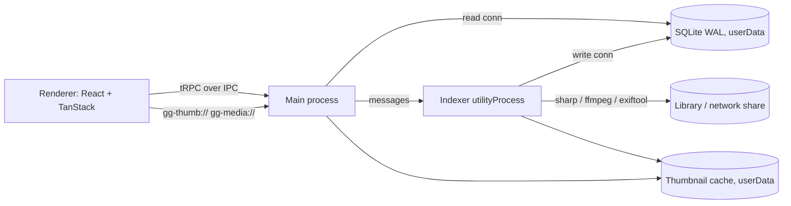

# Architecture

| Folder         | Role                                                                                       |
| -------------- | ------------------------------------------------------------------------------------------ |
| `src/main`     | Window and security, tRPC router over IPC, custom protocols, settings, scan scheduling     |
| `src/indexer`  | `utilityProcess`: scanning, file watcher, metadata (exiftool), thumbnails (sharp / ffmpeg) |
| `src/preload`  | Exposes only the tRPC IPC transport through `contextBridge`                                |
| `src/renderer` | React UI (TanStack Router / Query / Virtual, shadcn, Tailwind)                             |
| `src/shared`   | Code used by several processes (settings schema, tag helpers, media URLs, …)               |
| `drizzle/`     | SQL migrations, shipped with the app and applied at startup                                |
| `e2e/`         | Playwright smoke test against a generated fixture library                                  |

## Tech stack

- **Shell:** Electron, electron-vite, Vite
- **UI:** React, Tailwind CSS, shadcn/ui, TanStack Router / Query / Virtual
- **API:** tRPC over a custom IPC link, zod, superjson
- **Data:** better-sqlite3, Drizzle ORM
- **Media:** sharp, exiftool-vendored, ffmpeg-static, thumbhash
- **Tooling:** TypeScript 7, Biome, Vitest, Playwright, electron-builder

## Dependency placement

`electron-vite` bundles renderer and preload, but **externalizes `dependencies`** in the main process.

- `dependencies`: only packages loaded at runtime by main / indexer: native addons (`better-sqlite3`, `sharp`, `exiftool-vendored`, `ffmpeg-static`) and main-process libs (`@trpc/server`, `drizzle-orm`, `zod`, `superjson`).
- `devDependencies`: everything else (React, UI libs, tooling). `shadcn add` puts renderer deps into `dependencies`, so move them.

Only add a package if you import it directly; don't list transitive deps.
